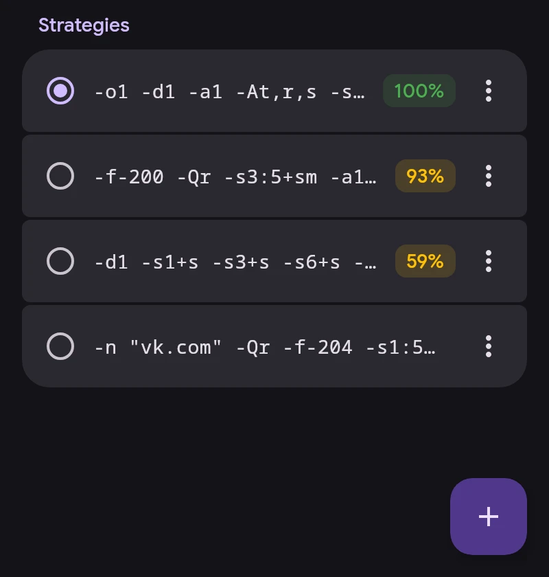

# ByeDPI

ByeDPI (ciadpi) alters packets on the device so the provider's DPI does not recognise them. No server is needed. How it alters them is set by a strategy, a set of ciadpi arguments.

## Strategies

- Tap a strategy to apply it. While connected, only ByeDPI restarts.
- The percentage is the share of sites that opened in the last test on the current network: Wi-Fi, or mobile with the operator. No percentage means it has not been tested on this network.
- ⋮ opens details per site and network, test, full test, edit, rename, pin and delete.
- Long-press to select several for deletion.
- The 30 most recent unpinned strategies are kept. Pinned ones and the active one are never dropped.

## Testing

Corner button → Test all. Each strategy runs in its own ciadpi, up to five at once; no VPN connection is needed. A site counts as open only if the whole page loads.

- The quick test checks 32 YouTube and Google Video addresses, as in ByeByeDPI.
- The full test adds Discord, Telegram, social networks, Cloudflare and more.

After Test all the list is sorted by result.

## Find strategy

Find strategy tests the ready list from ByeByeDPI, or your own list with one strategy per line. The SNI goes into strategies with fake packets, `google.com` by default. Good strategies can be applied or added to the list.

## DNS

Sites for ByeDPI traffic are resolved by ByeDPI DNS in Settings → Network: 1.1.1.1 with encryption (DoT) by default.

ciadpi arguments: [byedpi reference](https://github.com/hufrea/byedpi#readme).
