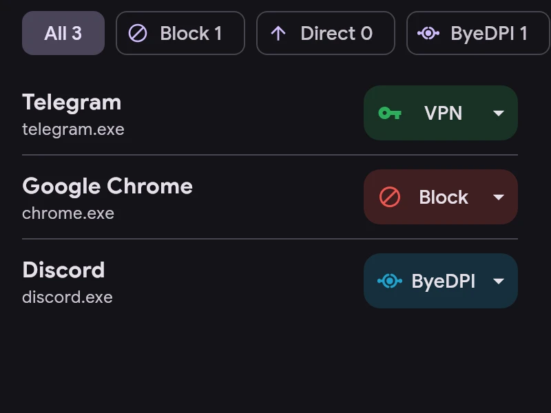

# Channels

Every app uses one channel:

- **Bypass** — around ERKIN, as without it. The app is outside the tunnel and rules do not apply to it. Android only.
- **Direct** — through ERKIN straight out, no server needed. Rules apply and the app shows up in Connections, but it sees the VPN.
- **ByeDPI** — through ByeDPI on the device, no server needed.
- **VPN** — through a server.
- **Block** — no network while ERKIN is connected.

- Tap the button to the right of an app to pick its channel. An app with its own server shows the server's name on the button.
- In the menu, the Server row under VPN gives the app its own server or chain instead of the main one.
- The chips above the list count the apps in each channel and filter the list. After the channels come the servers and chains that apps are bound to.
- To change several apps at once, long-press an app or tap the select button in the search field, check the apps and pick a channel or server. It can be undone.
- The channel for new apps is set in Settings → Applications. ru, vk and yandex apps start in Bypass.
- Rules win over the channel: a connection that matches a rule goes where the rule says. See Rules and connections.
- Block wins over shared rules: only the app's own rules open the network to a blocked app.

## Chains

In Chains you build a path through several servers: an entry, hops in between and an exit server. The first hop can be ByeDPI. Drag a hop by its handle to move it. A chain can be the main server or an app's server, and Test latency measures it end to end.
