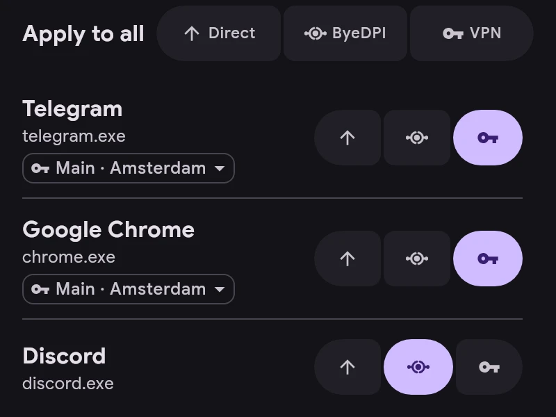

# Channels

Every app uses one channel:

- **Direct** — outside the tunnel, as without ERKIN.
- **ByeDPI** — through ByeDPI on the device, no server needed.
- **VPN** — through a server.

- Change the channel with the buttons to the right of an app.
- Apply to all sets the channel for every app in the list, or only for the search results. It can be undone.
- A VPN app shows its server under the name. Tap it to give the app its own server instead of the main one.
- The channel for new apps is set in Settings → Applications. ru, vk and yandex apps start in Direct.
- Rules win over the channel: a connection that matches a rule goes where the rule says.
