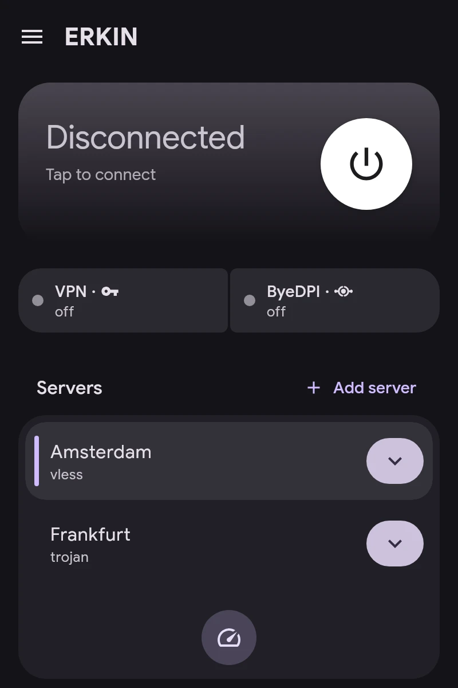

# Getting started

1. **Add a server.** On the home screen, tap Add server. It takes `vless://`, `vmess://`, `trojan://`, `ss://`, `hysteria2://`, `tuic://`, `anytls://`, `socks5://`, `https://` and AmneziaWG `vpn://` links, a subscription link, or a WireGuard, AmneziaWG or OpenVPN config file.
2. **Pick the main server** by tapping it in the list. Test latency measures every server.
3. **Give apps a channel** in Apps: VPN, ByeDPI or Direct. See Channels.
4. **Connect** with the button on the home screen.

The connection card shows the VPN and ByeDPI status. Tapping ByeDPI opens its page.
