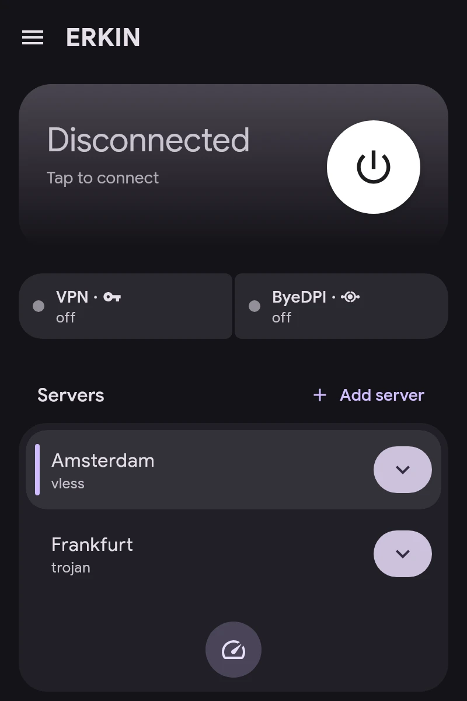

# Getting started

1. **Add a server.** On the home screen, tap Add server. It takes `vless://`, `vmess://`, `trojan://`, `ss://`, `hysteria2://`, `tuic://`, `anytls://`, `socks5://`, `https://`, AmneziaWG `vpn://` and `amneziawg://` links, a subscription link, or a WireGuard, AmneziaWG or OpenVPN config file.
2. **Pick the main server** by tapping it in the list. Test latency measures every server and chain; with Sort by ping the list follows the result.
3. **Give apps a channel** in Apps: Bypass, Direct, ByeDPI, VPN or Block. See Channels.
4. **Connect** with the button on the home screen or with the ERKIN tile in Quick Settings.

The connection card says Connected only when every channel in use answers. No response means the VPN server or ByeDPI does not answer; the line below says which. Tapping ByeDPI opens its page.

If the VPN server stops answering, ERKIN reconnects three times. If that does not help, it refreshes the subscription and switches to its fastest server.
