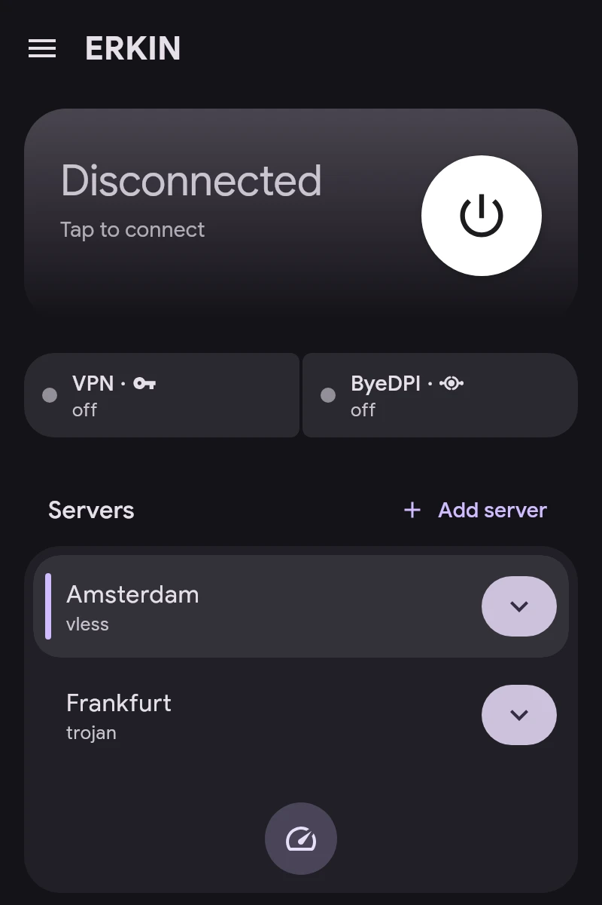

# Getting started

1. **Add a server.** On the home screen, tap Add server. It takes `vless://`, `vmess://`, `trojan://`, `ss://`, `hysteria2://`, `tuic://`, `anytls://`, `socks5://`, `https://`, AmneziaWG `vpn://` and `amneziawg://` links, a subscription link, or a WireGuard, AmneziaWG or OpenVPN config file.
2. **Pick the main server** by tapping it in the list. Test latency measures every server and chain; with Sort by ping the list follows the result. In a group with several servers, Whole group at the top of its sheet runs them all at once: sites are spread across the servers that answer, each site always through the same one, and the VPN status under the card shows how many answer.
3. **Give apps a channel** in Apps: Bypass, Direct, ByeDPI, VPN or Block. See Channels.
4. **Connect** with the button on the home screen or with the ERKIN tile in Quick Settings.

The connection card says Connected only when every channel in use answers. No response means the VPN server or ByeDPI does not answer; the line below says which. Tapping ByeDPI opens its page.

If the VPN server stops answering, ERKIN switches at once to the first other server of its group or subscription that answers. A server that worked before is tested again first, so a short change of network keeps it. If no other server answers, ERKIN reloads the core, then refreshes the subscription and looks again. With Whole group the core skips servers that stop answering by itself.

A subscription's sheet opens with its card: the traffic and the expiry, and when tapped, the last update, the provider's announcement and the Support and Account buttons. ERKIN refreshes a subscription as often as its provider asks, or once a day. A Clash subscription can also bring its own routing rules: turn on Apply in the card, and they work after your own rules while the main server comes from that subscription.
