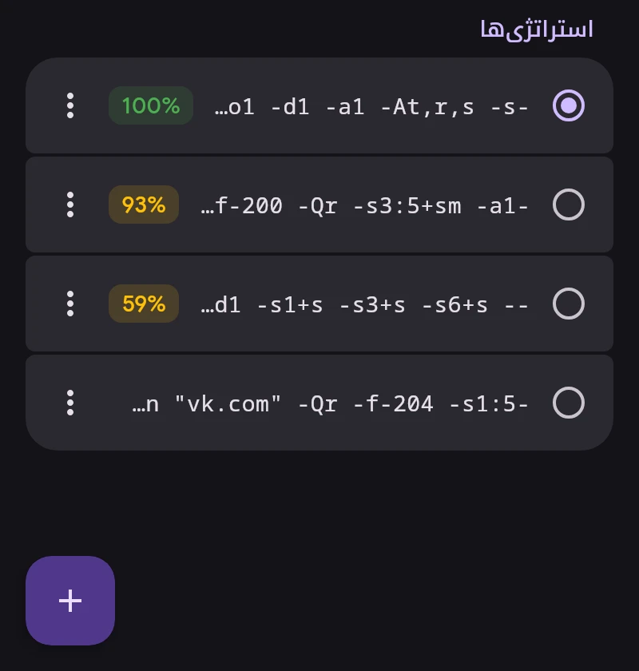

# ByeDPI

ByeDPI (ciadpi) بسته‌ها را روی دستگاه طوری تغییر می‌دهد که DPI ارائه‌دهنده آن‌ها را تشخیص ندهد. سرور لازم نیست. نحوهٔ تغییر را استراتژی تعیین می‌کند، یعنی مجموعه‌ای از آرگومان‌های ciadpi.

## استراتژی‌ها

- زدن روی استراتژی آن را اعمال می‌کند. اگر VPN وصل باشد، فقط ByeDPI دوباره راه‌اندازی می‌شود.
- درصد، سهم سایت‌هایی است که در آخرین آزمایش روی شبکهٔ فعلی باز شدند: Wi-Fi یا شبکهٔ موبایل همراه با اپراتور. نبودِ درصد یعنی استراتژی هنوز روی این شبکه آزمایش نشده.
- منوی ⋮: جزئیات بر اساس سایت و شبکه، تست، آزمایش کامل، ویرایش، تغییر نام، سنجاق، حذف.
- با نگه‌داشتن انگشت چند مورد را برای حذف انتخاب کنید.
- ۳۰ استراتژی آخرِ سنجاق‌نشده نگه داشته می‌شود. سنجاق‌شده‌ها و استراتژی فعال حذف نمی‌شوند.

## آزمایش

دکمهٔ گوشه ← «تست همه». هر استراتژی در یک ciadpi جداگانه اجرا می‌شود، حداکثر پنج تا هم‌زمان؛ اتصال VPN لازم نیست. سایت فقط وقتی باز شده حساب می‌شود که صفحه کامل بارگذاری شود.

- آزمایش سریع ۳۲ نشانی YouTube و Google Video را بررسی می‌کند، مانند ByeByeDPI.
- آزمایش کامل Discord، Telegram، شبکه‌های اجتماعی، Cloudflare و موارد دیگر را هم بررسی می‌کند.

پس از «تست همه» فهرست بر اساس نتیجه مرتب می‌شود.

## یافتن استراتژی

«یافتن استراتژی» فهرست آمادهٔ استراتژی‌های ByeByeDPI یا فهرست خودتان را، با یک استراتژی در هر خط، آزمایش می‌کند. SNI در استراتژی‌هایی که بستهٔ جعلی دارند قرار می‌گیرد، پیش‌فرض `google.com`. استراتژی‌های مناسب را می‌توان اعمال کرد یا به فهرست افزود.

## DNS

نشانی سایت‌ها برای ترافیک ByeDPI را «DNS برای ByeDPI» در «تنظیمات ← شبکه» پیدا می‌کند: به‌طور پیش‌فرض 1.1.1.1 با رمزگذاری (DoT).

آرگومان‌های ciadpi: [توضیحات byedpi](https://github.com/hufrea/byedpi#readme).
