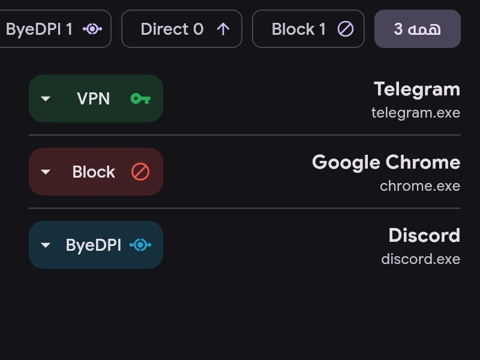

# کانال‌ها

هر برنامه از یکی از کانال‌ها استفاده می‌کند:

- **Bypass** — از کنار ERKIN، مثل وقتی که ERKIN نیست. برنامه بیرون از تونل است و قوانین روی آن اعمال نمی‌شوند. فقط در اندروید.
- **Direct** — مستقیم از طریق ERKIN، بدون نیاز به سرور. قوانین کار می‌کنند و برنامه در «اتصال‌ها» دیده می‌شود، اما VPN را می‌بیند.
- **ByeDPI** — از طریق ByeDPI روی دستگاه، بدون نیاز به سرور.
- **VPN** — از طریق سرور.
- **Block** — تا زمانی که ERKIN متصل است، بدون دسترسی به شبکه.

- کانال با دکمهٔ کنار هر برنامه انتخاب می‌شود. اگر برنامه سرور جداگانه داشته باشد، نام آن روی دکمه نوشته می‌شود.
- در منو، ردیف «سرور» زیر VPN برای برنامه به‌جای سرور اصلی یک سرور یا زنجیرهٔ جداگانه تعیین می‌کند.
- فیلترهای بالای فهرست تعداد برنامه‌های هر کانال را نشان می‌دهند و فهرست را صافی می‌کنند. پس از کانال‌ها، سرورها و زنجیره‌هایی می‌آیند که برنامه‌ها به آن‌ها وصل‌اند.
- برای تغییر چند برنامه با هم، روی یک برنامه نگه دارید یا دکمهٔ انتخاب را در کادر جست‌وجو بزنید، برنامه‌ها را علامت بزنید و کانال یا سرور را انتخاب کنید. قابل لغو است.
- کانال برنامه‌های جدید در «تنظیمات ← برنامه‌ها» تعیین می‌شود. برنامه‌های ru، vk و yandex با Bypass شروع می‌کنند.
- قوانین بر کانال مقدم‌اند: اتصالی که با قانونی منطبق شود به مقصد آن قانون می‌رود. جزئیات در مقالهٔ «قوانین و اتصال‌ها».
- Block بر قوانین عمومی مقدم است: شبکهٔ برنامهٔ مسدودشده را فقط قوانین خود آن برنامه باز می‌کنند.

## زنجیره‌ها

در «زنجیره‌ها» می‌توانید مسیری از چند سرور بسازید: ورودی، حلقه‌های میانی و سرور خروجی. حلقهٔ اول می‌تواند ByeDPI باشد. حلقه‌ها با کشیدن دستگیره جابه‌جا می‌شوند. زنجیره می‌تواند سرور اصلی یا سرور یک برنامه باشد و «آزمایش تأخیر» آن را از ابتدا تا انتها اندازه می‌گیرد.
