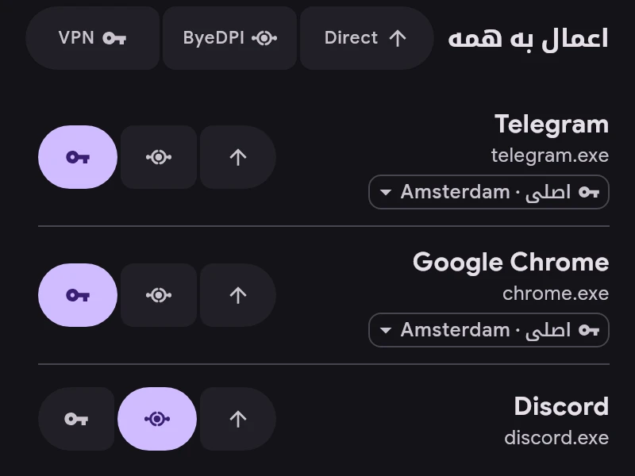

# کانال‌ها

هر برنامه از یکی از کانال‌ها استفاده می‌کند:

- **Direct** — بیرون از تونل، مثل وقتی که ERKIN نیست.
- **ByeDPI** — از طریق ByeDPI روی دستگاه، بدون نیاز به سرور.
- **VPN** — از طریق سرور.

- کانال با دکمه‌های کنار هر برنامه عوض می‌شود.
- «اعمال به همه» کانال را برای همهٔ برنامه‌های فهرست، و هنگام جست‌وجو فقط برای نتایج، تنظیم می‌کند. قابل لغو است.
- زیر نام برنامه‌ای که روی VPN است سرورش نوشته شده. برای انتخاب سرور جداگانه به‌جای سرور اصلی روی آن بزنید.
- کانال برنامه‌های جدید در «تنظیمات ← برنامه‌ها» تعیین می‌شود. برنامه‌های ru، vk و yandex با Direct شروع می‌کنند.
- قوانین بر کانال مقدم‌اند: اتصالی که با قانونی منطبق شود به مقصد آن قانون می‌رود.
