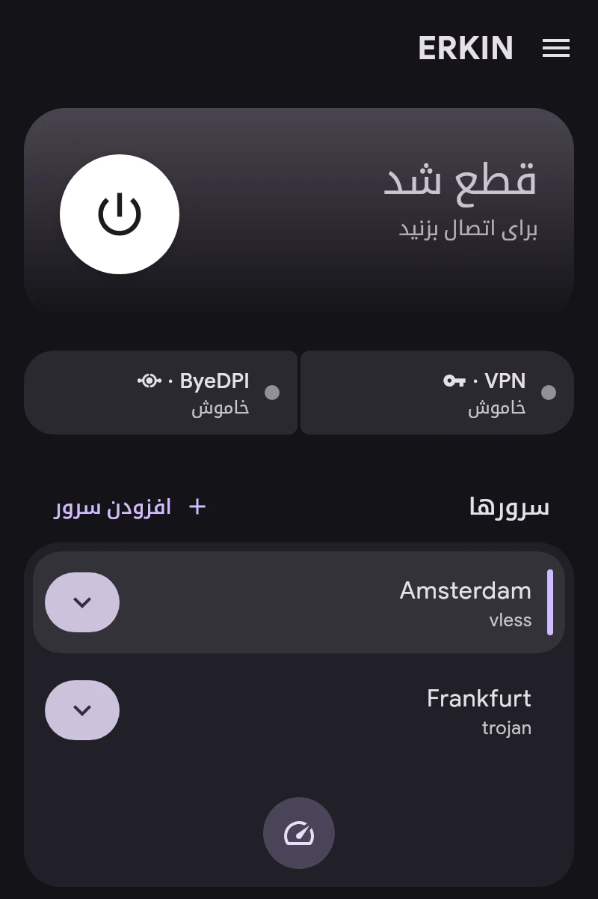

# شروع سریع

1. **سرور اضافه کنید.** در صفحهٔ اصلی «افزودن سرور» را بزنید. لینک‌های `vless://`، `vmess://`، `trojan://`، `ss://`، `hysteria2://`، `tuic://`، `anytls://`، `socks5://`، `https://` و AmneziaWG `vpn://`، `amneziawg://`، لینک اشتراک یا فایل پیکربندی WireGuard، AmneziaWG یا OpenVPN پذیرفته می‌شود.
2. **سرور اصلی را انتخاب کنید:** در فهرست روی آن بزنید. «آزمایش تأخیر» پاسخ همهٔ سرورها و زنجیره‌ها را اندازه می‌گیرد؛ با «مرتب‌سازی بر اساس پینگ» فهرست بر اساس نتیجه مرتب می‌شود.
3. **برای برنامه‌ها کانال تعیین کنید:** در «برنامه‌ها» یکی از Bypass، Direct، ByeDPI، VPN یا Block. جزئیات در مقالهٔ «کانال‌ها».
4. **وصل شوید** با دکمهٔ صفحهٔ اصلی یا کاشی ERKIN در تنظیمات سریع.

کارت اتصال فقط وقتی «متصل شد» را نشان می‌دهد که همهٔ کانال‌های در حال استفاده پاسخ دهند. «بدون پاسخ» یعنی سرور VPN یا ByeDPI پاسخ نمی‌دهد؛ کدام‌یک، در خط زیر آن نوشته شده. زدن روی ByeDPI صفحهٔ آن را باز می‌کند.

اگر سرور VPN پاسخ ندهد، ERKIN سه بار دوباره وصل می‌شود. اگر فایده نداشت، اشتراک را به‌روز می‌کند و به سریع‌ترین سرور آن می‌رود.
