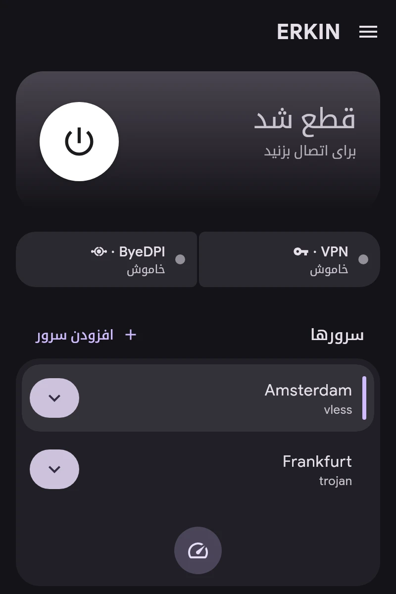

# شروع سریع

1. **سرور اضافه کنید.** در صفحهٔ اصلی «افزودن سرور» را بزنید. لینک‌های `vless://`، `vmess://`، `trojan://`، `ss://`، `hysteria2://`، `tuic://`، `anytls://`، `socks5://`، `https://` و AmneziaWG `vpn://`، `amneziawg://`، لینک اشتراک یا فایل پیکربندی WireGuard، AmneziaWG یا OpenVPN پذیرفته می‌شود.
2. **سرور اصلی را انتخاب کنید:** در فهرست روی آن بزنید. «آزمایش تأخیر» پاسخ همهٔ سرورها و زنجیره‌ها را اندازه می‌گیرد؛ با «مرتب‌سازی بر اساس پینگ» فهرست بر اساس نتیجه مرتب می‌شود.
3. **برای برنامه‌ها کانال تعیین کنید:** در «برنامه‌ها» یکی از Bypass، Direct، ByeDPI، VPN یا Block. جزئیات در مقالهٔ «کانال‌ها».
4. **وصل شوید** با دکمهٔ صفحهٔ اصلی یا کاشی ERKIN در تنظیمات سریع.

کارت اتصال فقط وقتی «متصل شد» را نشان می‌دهد که همهٔ کانال‌های در حال استفاده پاسخ دهند. «بدون پاسخ» یعنی سرور VPN یا ByeDPI پاسخ نمی‌دهد؛ کدام‌یک، در خط زیر آن نوشته شده. زدن روی ByeDPI صفحهٔ آن را باز می‌کند.

اگر سرور VPN دیگر پاسخ ندهد، ERKIN فوراً به اولین سرور پاسخ‌دهندهٔ همان گروه یا اشتراک می‌رود. سروری که پیش‌تر کار می‌کرد ابتدا دوباره آزمایش می‌شود، پس یک تغییر کوتاه شبکه آن را عوض نمی‌کند. اگر سرور دیگری پاسخ ندهد، ERKIN هسته را دوباره بارگذاری می‌کند، سپس اشتراک را به‌روز می‌کند و دوباره می‌گردد.

صفحهٔ هر اشتراک با کارت آن شروع می‌شود: ترافیک و تاریخ انقضا، و با زدن روی کارت، زمان آخرین به‌روزرسانی، اطلاعیهٔ ارائه‌دهنده و دکمه‌های «پشتیبانی» و «حساب». ERKIN اشتراک را هر قدر که ارائه‌دهنده بخواهد، یا روزی یک بار، به‌روز می‌کند. اشتراک Clash می‌تواند قوانین مسیریابی خودش را هم بیاورد: «اعمال» را در کارت روشن کنید تا وقتی سرور اصلی از همین اشتراک است، بعد از قوانین شما اعمال شوند.
