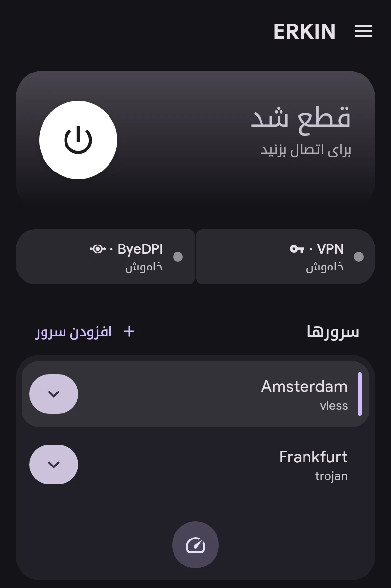

# شروع سریع

1. **سرور اضافه کنید.** در صفحهٔ اصلی «افزودن سرور» را بزنید. لینک‌های `vless://`، `vmess://`، `trojan://`، `ss://`، `hysteria2://`، `tuic://`، `anytls://`، `socks5://`، `https://` و AmneziaWG `vpn://`، لینک اشتراک یا فایل پیکربندی WireGuard، AmneziaWG یا OpenVPN پذیرفته می‌شود.
2. **سرور اصلی را انتخاب کنید:** در فهرست روی آن بزنید. «آزمایش تأخیر» پاسخ همهٔ سرورها را اندازه می‌گیرد.
3. **برای برنامه‌ها کانال تعیین کنید:** در «برنامه‌ها» یکی از VPN، ByeDPI یا Direct. جزئیات در مقالهٔ «کانال‌ها».
4. **وصل شوید** با دکمهٔ صفحهٔ اصلی.

کارت اتصال وضعیت VPN و ByeDPI را نشان می‌دهد. زدن روی ByeDPI صفحهٔ آن را باز می‌کند.
