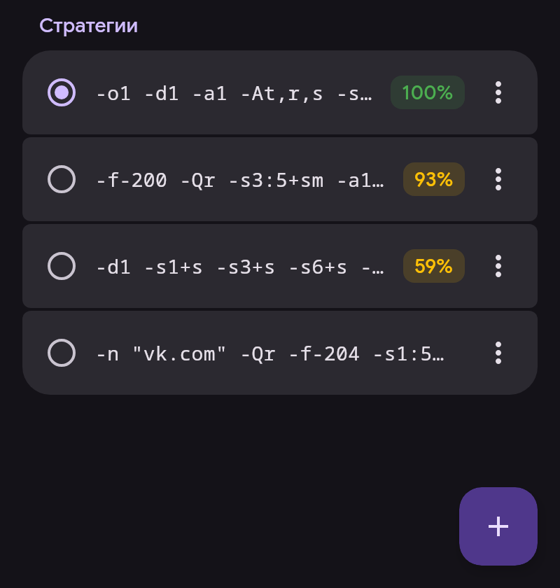

# ByeDPI

ByeDPI (ciadpi) меняет пакеты на устройстве так, чтобы DPI провайдера их не распознал. Сервер не нужен. Способ изменения задаёт стратегия — набор аргументов ciadpi.

## Стратегии

- Нажатие применяет стратегию. Если VPN подключён, перезапускается только ByeDPI.
- Процент — доля открывшихся сайтов при последней проверке в текущей сети: Wi-Fi или мобильная сеть с оператором. Нет процента — в этой сети стратегию ещё не проверяли.
- ⋮ — подробности по сайтам и сетям, проверка, полный тест, изменение, переименование, закрепление, удаление.
- Долгое нажатие — выбор нескольких для удаления.
- Хранятся 30 последних незакреплённых стратегий. Закреплённые и активная не удаляются.

## Проверка

Кнопка в углу → «Проверить все». Каждая стратегия запускается в отдельном ciadpi, до пяти одновременно; подключение VPN не нужно. Сайт считается открытым, только если страница загрузилась целиком.

- Быстрая проверка — 32 адреса YouTube и Google Video, как в ByeByeDPI.
- Полный тест — ещё Discord, Telegram, соцсети, Cloudflare и другие.

После «Проверить все» список сортируется по результату.

## Подбор

«Подбор» проверяет готовый список стратегий из ByeByeDPI или ваш список, по одной стратегии на строке. SNI подставляется в стратегии с поддельными пакетами, по умолчанию `google.com`. Подошедшие стратегии можно применить или добавить в список.

## DNS

Адреса сайтов для трафика ByeDPI определяет «DNS для ByeDPI» в «Настройки → Сеть»: по умолчанию 1.1.1.1 с шифрованием (DoT).

Аргументы ciadpi: [описание byedpi](https://github.com/hufrea/byedpi#readme).
