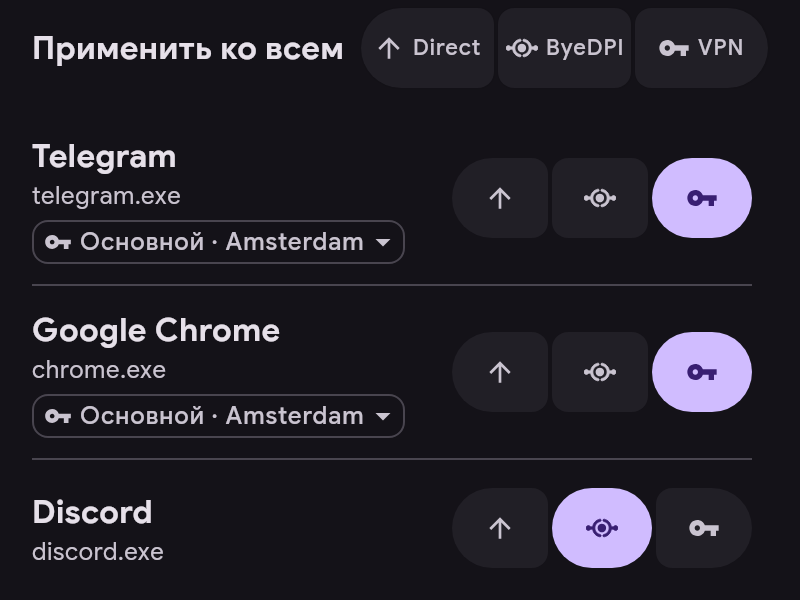

# Каналы

Каждое приложение идёт через один из каналов:

- **Напрямую** — мимо туннеля, как без ERKIN.
- **ByeDPI** — через ByeDPI на устройстве, сервер не нужен.
- **VPN** — через сервер.

- Канал меняется кнопками справа от приложения.
- «Применить ко всем» ставит канал всем приложениям в списке, а при поиске — только найденным. Действие можно отменить.
- У приложения на VPN под названием указан сервер. Нажмите на него, чтобы выбрать приложению свой сервер вместо основного.
- Канал для новых приложений задаётся в «Настройки → Приложения». Приложения ru, vk и yandex начинают с «Напрямую».
- Правила важнее канала: если соединение совпало с правилом, оно идёт туда, куда указывает правило.
