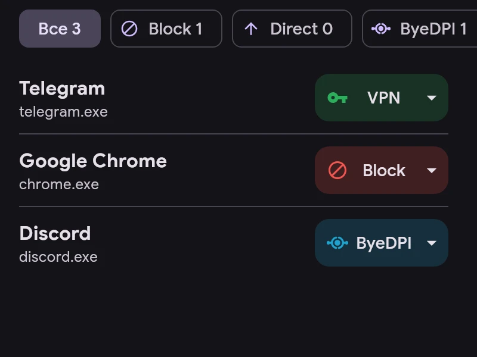

# Каналы

Каждое приложение идёт через один из каналов:

- **Bypass** — мимо ERKIN, как без него. Приложение вне туннеля, правила на него не действуют. Есть только на Android.
- **Direct** — через ERKIN напрямую, без сервера. Работают правила, приложение видно в «Соединениях», но оно видит VPN.
- **ByeDPI** — через ByeDPI на устройстве, сервер не нужен.
- **VPN** — через сервер.
- **Block** — без доступа к сети, пока ERKIN подключён.

- Канал выбирается кнопкой справа от приложения. Если у приложения свой сервер, на кнопке написано его название.
- В меню под VPN строка «Сервер» задаёт приложению свой сервер или цепочку вместо основного.
- Фильтры над списком показывают, сколько приложений в каждом канале, и отбирают их. После каналов идут серверы и цепочки, к которым привязаны приложения.
- Чтобы изменить сразу несколько приложений, удерживайте приложение или нажмите кнопку выбора в поле поиска, отметьте приложения и выберите канал или сервер. Действие можно отменить.
- Канал для новых приложений задаётся в «Настройки → Приложения». Приложения ru, vk и yandex начинают с Bypass.
- Правила важнее канала: если соединение совпало с правилом, оно идёт туда, куда указывает правило. Подробнее — в статье «Правила и соединения».
- Block важнее общих правил: заблокированному приложению сеть открывают только его собственные правила.

## Цепочки

В разделе «Цепочки» можно собрать путь из нескольких серверов: вход, промежуточные звенья и сервер выхода. Первым звеном может быть ByeDPI. Звенья переставляются перетаскиванием за ручку. Цепочку можно выбрать основным сервером или сервером приложения, а «Проверить задержку» измеряет её целиком.
