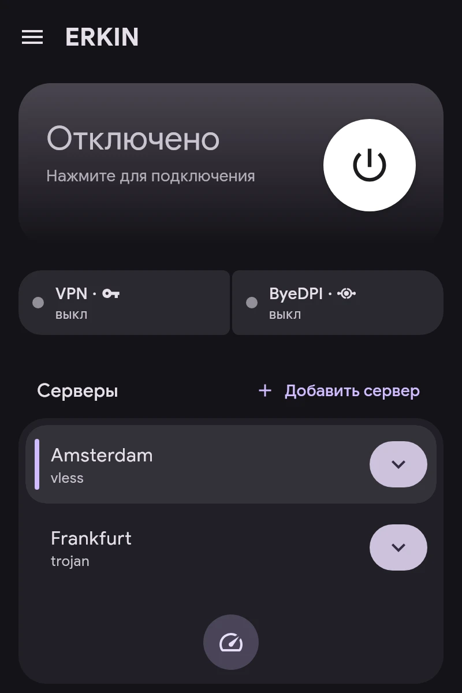

# Быстрый старт

1. **Добавьте сервер.** На главном экране — «Добавить сервер». Подходят ссылки `vless://`, `vmess://`, `trojan://`, `ss://`, `hysteria2://`, `tuic://`, `anytls://`, `socks5://`, `https://`, AmneziaWG `vpn://`, ссылка на подписку или файл конфигурации WireGuard, AmneziaWG и OpenVPN.
2. **Выберите основной сервер** — нажмите на него в списке. «Проверить задержку» измеряет отклик всех серверов.
3. **Назначьте приложениям каналы** в разделе «Приложения»: VPN, ByeDPI или Direct. Подробнее — в статье «Каналы».
4. **Подключитесь** кнопкой на главном экране.

Карточка подключения показывает статус VPN и ByeDPI. Нажатие на ByeDPI открывает его раздел.
