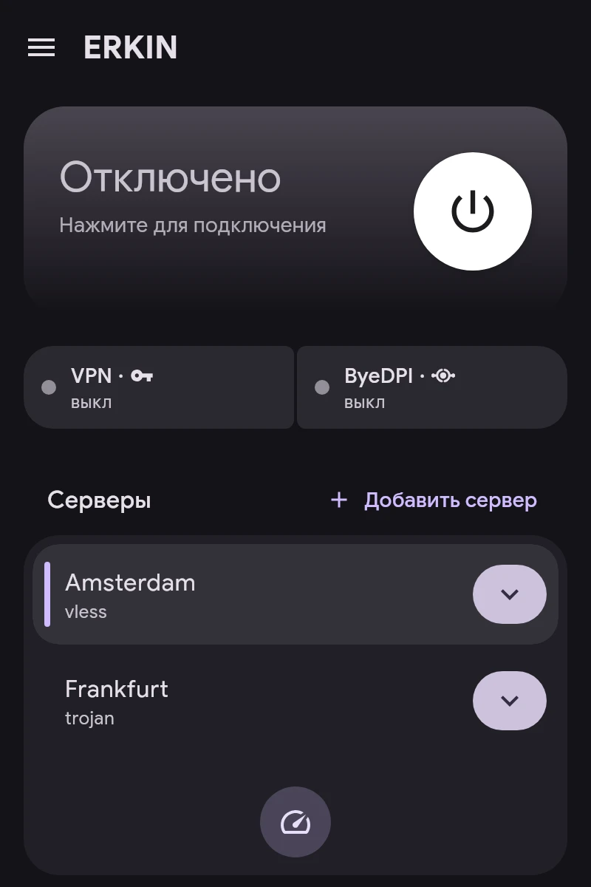

# Быстрый старт

1. **Добавьте сервер.** На главном экране — «Добавить сервер». Подходят ссылки `vless://`, `vmess://`, `trojan://`, `ss://`, `hysteria2://`, `tuic://`, `anytls://`, `socks5://`, `https://`, AmneziaWG `vpn://` и `amneziawg://`, ссылка на подписку или файл конфигурации WireGuard, AmneziaWG и OpenVPN.
2. **Выберите основной сервер** — нажмите на него в списке. «Проверить задержку» измеряет отклик всех серверов и цепочек; со «Сортировать по пингу» список упорядочивается по результату.
3. **Назначьте приложениям каналы** в разделе «Приложения»: Bypass, Direct, ByeDPI, VPN или Block. Подробнее — в статье «Каналы».
4. **Подключитесь** кнопкой на главном экране или плиткой ERKIN в шторке быстрых настроек.

Карточка подключения показывает «Подключено», только когда отвечают все используемые каналы. «Нет ответа» означает, что не отвечает VPN-сервер или ByeDPI: в подписи сказано, какой именно. Нажатие на ByeDPI открывает его раздел.

Если VPN-сервер перестал отвечать, ERKIN сразу переходит на первый ответивший сервер той же группы или подписки. Сервер, который до этого работал, сначала проверяется ещё раз, поэтому короткая смена сети его не меняет. Если другие серверы не отвечают, ERKIN перезапускает ядро, затем обновляет подписку и ищет снова.

Шторка подписки начинается с её карточки: трафик и срок действия, а после нажатия — время обновления, объявление провайдера и кнопки «Поддержка» и «Кабинет». ERKIN обновляет подписку так часто, как просит провайдер, или раз в сутки. Подписка Clash может принести и свои правила маршрутизации: включите «Применять» в карточке, и они будут работать после ваших правил, пока основной сервер взят из этой подписки.
