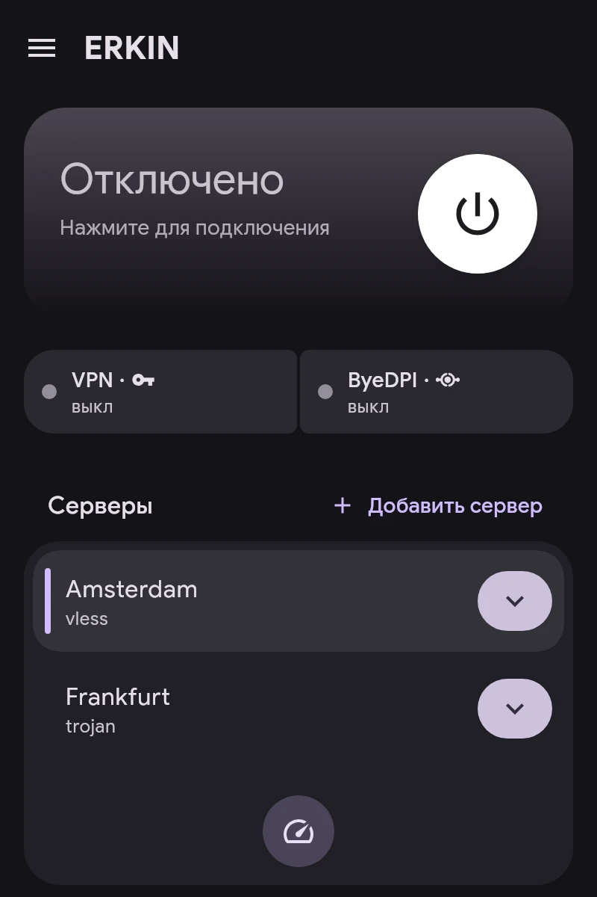

# Быстрый старт

1. **Добавьте сервер.** На главном экране — «Добавить сервер». Подходят ссылки `vless://`, `vmess://`, `trojan://`, `ss://`, `hysteria2://`, `tuic://`, `anytls://`, `socks5://`, `https://`, AmneziaWG `vpn://` и `amneziawg://`, ссылка на подписку или файл конфигурации WireGuard, AmneziaWG и OpenVPN.
2. **Выберите основной сервер** — нажмите на него в списке. «Проверить задержку» измеряет отклик всех серверов и цепочек; со «Сортировать по пингу» список упорядочивается по результату.
3. **Назначьте приложениям каналы** в разделе «Приложения»: Bypass, Direct, ByeDPI, VPN или Block. Подробнее — в статье «Каналы».
4. **Подключитесь** кнопкой на главном экране или плиткой ERKIN в шторке быстрых настроек.

Карточка подключения показывает «Подключено», только когда отвечают все используемые каналы. «Нет ответа» означает, что не отвечает VPN-сервер или ByeDPI: в подписи сказано, какой именно. Нажатие на ByeDPI открывает его раздел.

Если VPN-сервер не отвечает, ERKIN трижды переподключается. Если не помогло, он обновляет подписку и переключается на самый быстрый из её серверов.
