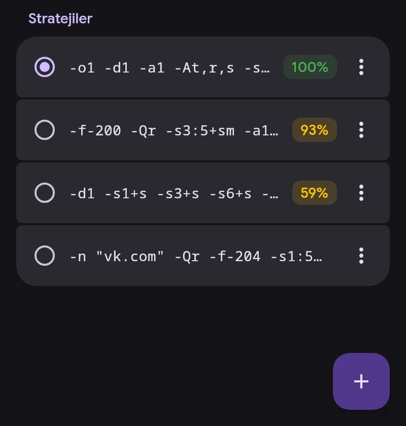

# ByeDPI

ByeDPI (ciadpi) paketleri cihazda, sağlayıcının DPI’ı tanımayacağı şekilde değiştirir. Sunucu gerekmez. Nasıl değiştireceğini bir strateji, yani ciadpi argümanları kümesi belirler.

## Stratejiler

- Bir stratejiye dokunmak onu uygular. VPN bağlıyken yalnızca ByeDPI yeniden başlar.
- Yüzde, geçerli ağdaki son testte açılan sitelerin oranıdır: Wi-Fi ya da operatörüyle birlikte mobil ağ. Yüzde yoksa strateji bu ağda henüz test edilmemiştir.
- ⋮ menüsü: site ve ağ ayrıntıları, test, tam test, düzenleme, yeniden adlandırma, sabitleme, silme.
- Uzun basarak silmek için birkaçını seçin.
- Sabitlenmemiş son 30 strateji saklanır. Sabitlenenler ve etkin olan silinmez.

## Test

Köşedeki düğme → Tümünü test et. Her strateji ayrı bir ciadpi’da, aynı anda en fazla beş tane çalışır; VPN bağlantısı gerekmez. Bir site yalnızca sayfa tamamen yüklendiğinde açık sayılır.

- Hızlı test, ByeByeDPI’daki gibi 32 YouTube ve Google Video adresini dener.
- Tam test buna Discord, Telegram, sosyal ağlar, Cloudflare ve daha fazlasını ekler.

Tümünü test et’ten sonra liste sonuca göre sıralanır.

## Strateji bul

Strateji bul, ByeByeDPI’daki hazır listeyi ya da her satırda bir strateji olan kendi listenizi test eder. SNI sahte paketli stratejilere eklenir, varsayılanı `google.com`. Uygun stratejiler uygulanabilir veya listeye eklenebilir.

## DNS

ByeDPI trafiğindeki site adlarını Ayarlar → Ağ’daki ByeDPI DNS çözer: varsayılan olarak şifreli (DoT) 1.1.1.1.

ciadpi argümanları: [byedpi açıklaması](https://github.com/hufrea/byedpi#readme).
