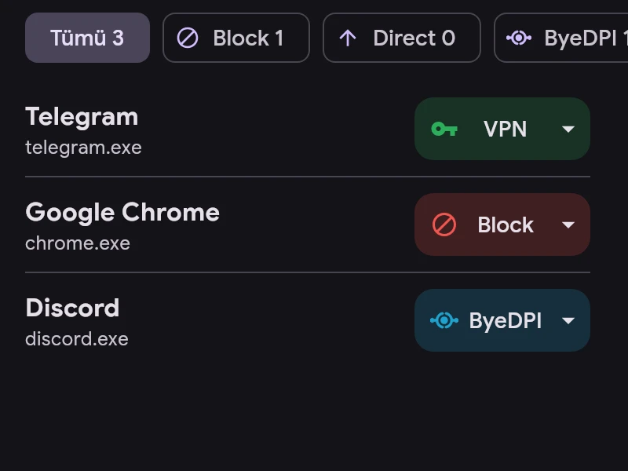

# Kanallar

Her uygulama bir kanal kullanır:

- **Bypass** — ERKIN’in dışından, o yokmuş gibi. Uygulama VPN’i görmez, kurallar ona uygulanmaz. Yalnızca Android’de.
- **Direct** — ERKIN üzerinden doğrudan, sunucu gerekmez. Kurallar çalışır ve uygulama Bağlantılar’da görünür, ama VPN’i görür.
- **ByeDPI** — cihazdaki ByeDPI üzerinden, sunucu gerekmez.
- **VPN** — bir sunucu üzerinden.
- **Block** — ERKIN bağlıyken ağ erişimi yok.

- Kanal, uygulamanın sağındaki düğmeyle seçilir. Uygulamanın kendi sunucusu varsa düğmede sunucunun adı yazar.
- Menüde VPN'in altındaki Sunucu satırı, uygulamaya ana sunucu yerine kendi sunucusunu veya zincirini verir.
- Listenin üstündeki filtreler her kanaldaki uygulama sayısını gösterir ve listeyi süzer. Kanallardan sonra uygulamaların bağlı olduğu sunucular ve zincirler gelir.
- Birden fazla uygulamayı aynı anda değiştirmek için bir uygulamaya uzun basın veya arama alanındaki seçim düğmesine dokunun, uygulamaları işaretleyin ve bir kanal ya da sunucu seçin. Geri alınabilir.
- Yeni uygulamaların kanalı Ayarlar → Uygulamalar'da belirlenir. ru, vk ve yandex uygulamaları Bypass ile başlar.
- Kurallar kanaldan önce gelir: bir kurala uyan bağlantı, kuralın gösterdiği yere gider. Ayrıntılar Kurallar ve bağlantılar makalesinde.
- Block genel kurallardan önce gelir: engellenen uygulamaya ağı yalnızca kendi kuralları açar.

## Zincirler

Zincirler bölümünde birkaç sunucudan bir yol kurabilirsiniz: giriş, aradaki halkalar ve çıkış sunucusu. İlk halka ByeDPI olabilir. Halkalar tutamaçtan sürüklenerek yer değiştirir. Zincir ana sunucu ya da bir uygulamanın sunucusu olabilir; Gecikmeyi test et onu baştan sona ölçer.
