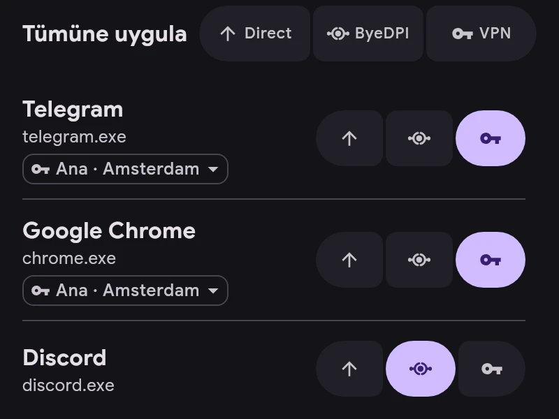

# Kanallar

Her uygulama bir kanal kullanır:

- **Direct** — tünelin dışından, ERKIN yokmuş gibi.
- **ByeDPI** — cihazdaki ByeDPI üzerinden, sunucu gerekmez.
- **VPN** — bir sunucu üzerinden.

- Kanal, uygulamanın sağındaki düğmelerle değiştirilir.
- Tümüne uygula kanalı listedeki tüm uygulamalara, aramada ise yalnızca bulunanlara uygular. Geri alınabilir.
- VPN’deki bir uygulamanın adının altında sunucusu yazar. Ana sunucu yerine uygulamaya kendi sunucusunu seçmek için üzerine dokunun.
- Yeni uygulamaların kanalı Ayarlar → Uygulamalar’da belirlenir. ru, vk ve yandex uygulamaları Direct ile başlar.
- Kurallar kanaldan önce gelir: bir kurala uyan bağlantı, kuralın gösterdiği yere gider.
