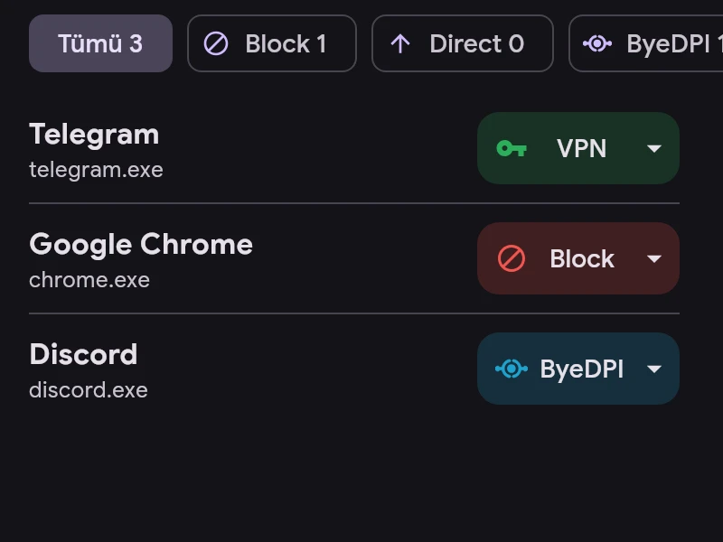

# Kanallar

Her uygulama bir kanal kullanır:

- **Bypass** — ERKIN’in dışından, o yokmuş gibi. Uygulama tünelin dışında, kurallar ona uygulanmaz. Yalnızca Android’de.
- **Direct** — ERKIN üzerinden doğrudan, sunucu gerekmez. Kurallar çalışır ve uygulama Bağlantılar’da görünür, ama VPN’i görür.
- **ByeDPI** — cihazdaki ByeDPI üzerinden, sunucu gerekmez.
- **VPN** — bir sunucu üzerinden.
- **Block** — ERKIN bağlıyken ağ erişimi yok.

- Kanal, uygulamanın sağındaki düğmeyle seçilir. Uygulamanın kendi sunucusu varsa düğmede sunucunun adı yazar.
- Menüde VPN'in altındaki Sunucu satırı, uygulamaya ana sunucu yerine kendi sunucusunu veya zincirini verir.
- Listenin üstündeki filtreler her kanaldaki uygulama sayısını gösterir ve listeyi süzer. Kanallardan sonra uygulamaların bağlı olduğu sunucular ve zincirler gelir.
- Birden fazla uygulamayı aynı anda değiştirmek için bir uygulamaya uzun basın veya arama alanındaki seçim düğmesine dokunun, uygulamaları işaretleyin ve bir kanal ya da sunucu seçin. Geri alınabilir.
- Yeni uygulamaların kanalı Ayarlar → Uygulamalar'da belirlenir. ru, vk ve yandex uygulamaları Bypass ile başlar.
- Kurallar kanaldan önce gelir: bir kurala uyan bağlantı, kuralın gösterdiği yere gider. Ayrıntılar Kurallar ve bağlantılar makalesinde.
- Block genel kurallardan önce gelir: engellenen uygulamaya ağı yalnızca kendi kuralları açar.

## Linux’ta programlar

Linux’ta kendi kanalı olmayan bir program, onu başlatan programın kanalını kullanır. Terminal Direct’e ayarlıysa ondan başlatılan her şey, örneğin curl, git ya da bir tarayıcı, de doğrudan çıkar. Programın kendi kanalı devralınan kanaldan önce gelir. Yeni uygulamaların kanalı kendi kanalı sayılmaz: bu kanalda program devralmaya devam eder.

Bu yüzden her kanal için ayrı bir terminal kullanmak pratiktir: örneğin ByeDPI’da foot, VPN’de kitty. Bir komut, başlatıldığı terminalin kanalından gider. Zaten açık olan bir tarayıcı kendi kanalında kalır, çünkü terminaldeki komut adresi yalnızca çalışan pencereye iletir.

## Zincirler

Zincirler bölümünde birkaç sunucudan bir yol kurabilirsiniz: giriş, aradaki halkalar ve çıkış sunucusu. İlk halka ByeDPI olabilir. Halkalar tutamaçtan sürüklenerek yer değiştirir. Zincir ana sunucu ya da bir uygulamanın sunucusu olabilir; Gecikmeyi test et onu baştan sona ölçer.
