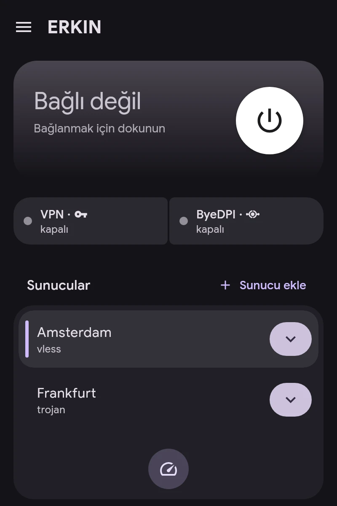

# Hızlı başlangıç

1. **Sunucu ekleyin.** Ana ekranda Sunucu ekle’ye dokunun. `vless://`, `vmess://`, `trojan://`, `ss://`, `hysteria2://`, `tuic://`, `anytls://`, `socks5://`, `https://` ve AmneziaWG `vpn://`, `amneziawg://` bağlantıları, abonelik bağlantısı ya da WireGuard, AmneziaWG veya OpenVPN yapılandırma dosyası kabul edilir.
2. **Ana sunucuyu seçin:** listede üzerine dokunun. Gecikmeyi test et tüm sunucuların ve zincirlerin yanıtını ölçer; Ping’e göre sırala açıksa liste sonuca göre sıralanır. Birden çok sunucusu olan bir grupta, sayfasının üstündeki Tüm grup hepsini birden çalıştırır: siteler yanıt veren sunuculara dağıtılır, her site hep aynı sunucudan geçer ve kartın altında kaç sunucunun yanıt verdiği görünür.
3. **Uygulamalara kanal atayın:** Uygulamalar bölümünde Bypass, Direct, ByeDPI, VPN veya Block. Ayrıntılar Kanallar makalesinde.
4. **Bağlanın:** ana ekrandaki düğmeyle ya da Hızlı Ayarlar’daki ERKIN kutucuğuyla.

Bağlantı kartı yalnızca kullanılan tüm kanallar yanıt verdiğinde Bağlandı der. Yanıt yok, VPN sunucusunun ya da ByeDPI’ın yanıt vermediği anlamına gelir; hangisi olduğu alttaki satırda yazar. ByeDPI’a dokunmak sayfasını açar.

VPN sunucusu yanıt vermeyi keserse ERKIN hemen aynı grubun ya da aboneliğin yanıt veren ilk sunucusuna geçer. Daha önce çalışan bir sunucu önce yeniden test edilir; kısa bir ağ değişikliği onu değiştirmez. Başka sunucu yanıt vermezse ERKIN çekirdeği yeniden yükler, sonra aboneliği yenileyip yeniden arar. Tüm grup kullanılırken yanıt vermeyen sunucuları çekirdek kendisi atlar.

Bir aboneliğin sayfası kartıyla açılır: trafik ve bitiş tarihi; karta dokununca son güncelleme, sağlayıcının duyurusu ve Destek ile Hesap düğmeleri. ERKIN aboneliği sağlayıcının istediği sıklıkta ya da günde bir kez yeniler. Bir Clash aboneliği kendi yönlendirme kurallarını da getirebilir: kartta Uygula’yı açın; ana sunucu o abonelikten geldiği sürece sizin kurallarınızdan sonra çalışırlar.
