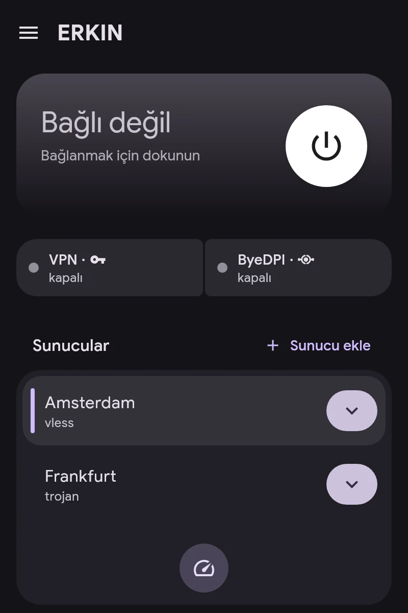

# Hızlı başlangıç

1. **Sunucu ekleyin.** Ana ekranda Sunucu ekle’ye dokunun. `vless://`, `vmess://`, `trojan://`, `ss://`, `hysteria2://`, `tuic://`, `anytls://`, `socks5://`, `https://` ve AmneziaWG `vpn://` bağlantıları, abonelik bağlantısı ya da WireGuard, AmneziaWG veya OpenVPN yapılandırma dosyası kabul edilir.
2. **Ana sunucuyu seçin:** listede üzerine dokunun. Gecikmeyi test et tüm sunucuların ve zincirlerin yanıtını ölçer; Ping’e göre sırala açıksa liste sonuca göre sıralanır.
3. **Uygulamalara kanal atayın:** Uygulamalar bölümünde Bypass, Direct, ByeDPI, VPN veya Block. Ayrıntılar Kanallar makalesinde.
4. **Bağlanın:** ana ekrandaki düğmeyle ya da Hızlı Ayarlar’daki ERKIN kutucuğuyla.

Bağlantı kartı yalnızca kullanılan tüm kanallar yanıt verdiğinde Bağlandı der. Yanıt yok, VPN sunucusunun ya da ByeDPI’ın yanıt vermediği anlamına gelir; hangisi olduğu alttaki satırda yazar. ByeDPI’a dokunmak sayfasını açar.

VPN sunucusu yanıt vermeyi keserse ERKIN üç kez yeniden bağlanır. Bu işe yaramazsa aboneliği yeniler ve en hızlı sunucusuna geçer.
