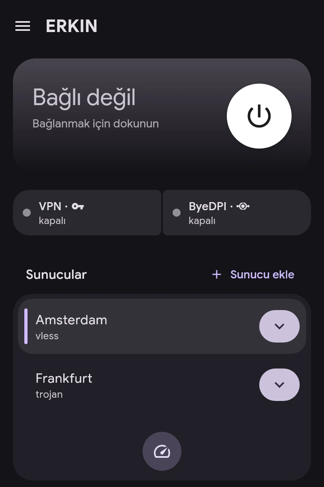

# Hızlı başlangıç

1. **Sunucu ekleyin.** Ana ekranda Sunucu ekle’ye dokunun. `vless://`, `vmess://`, `trojan://`, `ss://`, `hysteria2://`, `tuic://`, `anytls://`, `socks5://`, `https://` ve AmneziaWG `vpn://` bağlantıları, abonelik bağlantısı ya da WireGuard, AmneziaWG veya OpenVPN yapılandırma dosyası kabul edilir.
2. **Ana sunucuyu seçin:** listede üzerine dokunun. Gecikmeyi test et tüm sunucuların yanıtını ölçer.
3. **Uygulamalara kanal atayın:** Uygulamalar bölümünde VPN, ByeDPI veya Direct. Ayrıntılar Kanallar makalesinde.
4. **Bağlanın:** ana ekrandaki düğmeyle.

Bağlantı kartı VPN ve ByeDPI durumunu gösterir. ByeDPI’a dokunmak sayfasını açar.
