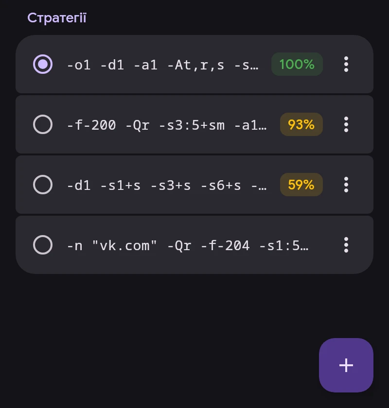

# ByeDPI

ByeDPI (ciadpi) змінює пакети на пристрої так, щоб DPI провайдера їх не розпізнав. Сервер не потрібен. Спосіб зміни задає стратегія — набір аргументів ciadpi.

## Стратегії

- Натискання застосовує стратегію. Якщо VPN підключено, перезапускається лише ByeDPI.
- Відсоток — частка сайтів, що відкрилися під час останньої перевірки в поточній мережі: Wi-Fi або мобільна мережа з оператором. Немає відсотка — у цій мережі стратегію ще не перевіряли.
- ⋮ — докладно за сайтами й мережами, перевірка, повний тест, зміна, перейменування, закріплення, видалення.
- Довге натискання — вибір кількох для видалення.
- Зберігаються 30 останніх незакріплених стратегій. Закріплені й активна не видаляються.

## Перевірка

Кнопка в куті → «Перевірити всі». Кожна стратегія запускається в окремому ciadpi, до п’яти одночасно; підключення VPN не потрібне. Сайт вважається відкритим, лише якщо сторінка завантажилася повністю.

- Швидка перевірка — 32 адреси YouTube і Google Video, як у ByeByeDPI.
- Повний тест — ще Discord, Telegram, соцмережі, Cloudflare та інші.

Після «Перевірити всі» список сортується за результатом.

## Підбір

«Підбір» перевіряє готовий список стратегій із ByeByeDPI або ваш список, по одній стратегії на рядок. SNI підставляється в стратегії з підробленими пакетами, за замовчуванням `google.com`. Відповідні стратегії можна застосувати або додати до списку.

## DNS

Адреси сайтів для трафіку ByeDPI визначає «DNS для ByeDPI» в «Налаштування → Мережа»: за замовчуванням 1.1.1.1 із шифруванням (DoT).

Аргументи ciadpi: [опис byedpi](https://github.com/hufrea/byedpi#readme).
