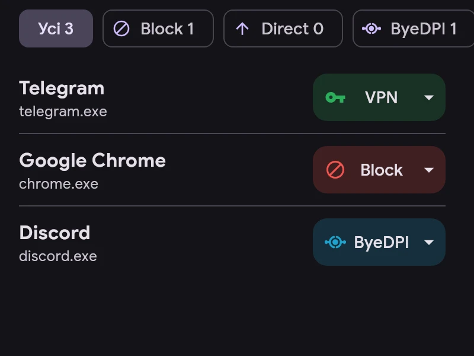

# Канали

Кожен застосунок іде через один із каналів:

- **Direct** — повз тунель, як без ERKIN.
- **ByeDPI** — через ByeDPI на пристрої, сервер не потрібен.
- **VPN** — через сервер.
- **Block** — без доступу до мережі, доки ERKIN підключено.

- Канал вибирається кнопкою праворуч від застосунку. Якщо в застосунку власний сервер, на кнопці написано його назву.
- У меню під VPN рядок «Сервер» задає застосунку власний сервер або ланцюжок замість основного.
- Фільтри над списком показують, скільки застосунків у кожному каналі, і відбирають їх.
- Щоб змінити кілька застосунків одразу, утримуйте застосунок або натисніть кнопку вибору в полі пошуку, позначте застосунки й виберіть канал чи сервер. Дію можна скасувати.
- Канал для нових застосунків задається в «Налаштування → Застосунки». Застосунки ru, vk і yandex починають із Direct.
- Правила важливіші за канал: якщо з’єднання збіглося з правилом, воно йде туди, куди вказує правило. VPN-правило теж може мати власний сервер.
- Block важливіший за правила: заблокований застосунок зовсім не отримує мережу.
