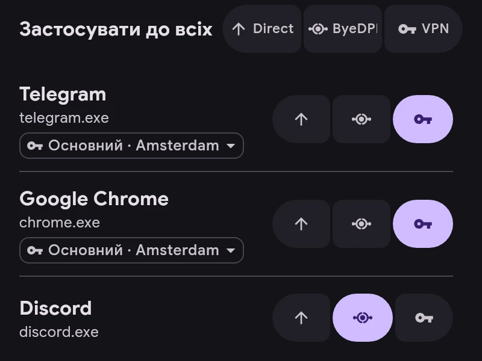

# Канали

Кожен застосунок іде через один із каналів:

- **Direct** — повз тунель, як без ERKIN.
- **ByeDPI** — через ByeDPI на пристрої, сервер не потрібен.
- **VPN** — через сервер.

- Канал змінюється кнопками праворуч від застосунку.
- «Застосувати до всіх» ставить канал усім застосункам у списку, а під час пошуку — лише знайденим. Дію можна скасувати.
- У застосунку на VPN під назвою вказано сервер. Натисніть на нього, щоб вибрати застосунку власний сервер замість основного.
- Канал для нових застосунків задається в «Налаштування → Застосунки». Застосунки ru, vk і yandex починають із Direct.
- Правила важливіші за канал: якщо з’єднання збіглося з правилом, воно йде туди, куди вказує правило.
