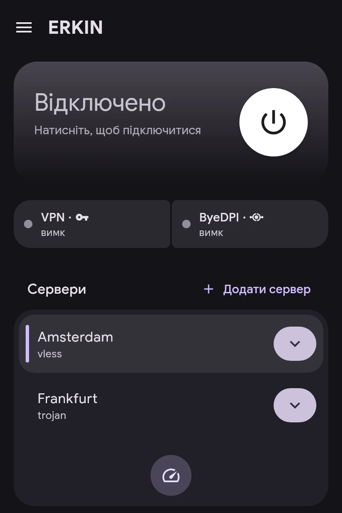

# Швидкий старт

1. **Додайте сервер.** На головному екрані — «Додати сервер». Підходять посилання `vless://`, `vmess://`, `trojan://`, `ss://`, `hysteria2://`, `tuic://`, `anytls://`, `socks5://`, `https://`, AmneziaWG `vpn://`, посилання на підписку або файл конфігурації WireGuard, AmneziaWG чи OpenVPN.
2. **Виберіть основний сервер** — натисніть на нього в списку. «Перевірити затримку» вимірює відгук усіх серверів і ланцюжків; із «Сортувати за пінгом» список упорядковується за результатом.
3. **Призначте застосункам канали** в розділі «Застосунки»: Bypass, Direct, ByeDPI, VPN або Block. Докладніше — у статті «Канали».
4. **Підключіться** кнопкою на головному екрані або плиткою ERKIN у шторці швидких налаштувань.

Картка підключення показує «Підключено», лише коли відповідають усі канали, що використовуються. «Немає відповіді» означає, що не відповідає VPN-сервер або ByeDPI: у підписі сказано, який саме. Натискання на ByeDPI відкриває його розділ.

Якщо VPN-сервер не відповідає, ERKIN тричі перепідключається. Якщо не допомогло, він оновлює підписку й перемикається на найшвидший із її серверів.
