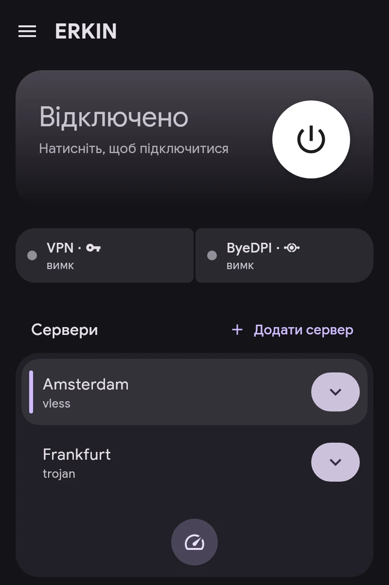

# Швидкий старт

1. **Додайте сервер.** На головному екрані — «Додати сервер». Підходять посилання `vless://`, `vmess://`, `trojan://`, `ss://`, `hysteria2://`, `tuic://`, `anytls://`, `socks5://`, `https://`, AmneziaWG `vpn://`, посилання на підписку або файл конфігурації WireGuard, AmneziaWG чи OpenVPN.
2. **Виберіть основний сервер** — натисніть на нього в списку. «Перевірити затримку» вимірює відгук усіх серверів.
3. **Призначте застосункам канали** в розділі «Застосунки»: VPN, ByeDPI або Direct. Докладніше — у статті «Канали».
4. **Підключіться** кнопкою на головному екрані.

Картка підключення показує стан VPN і ByeDPI. Натискання на ByeDPI відкриває його розділ.
