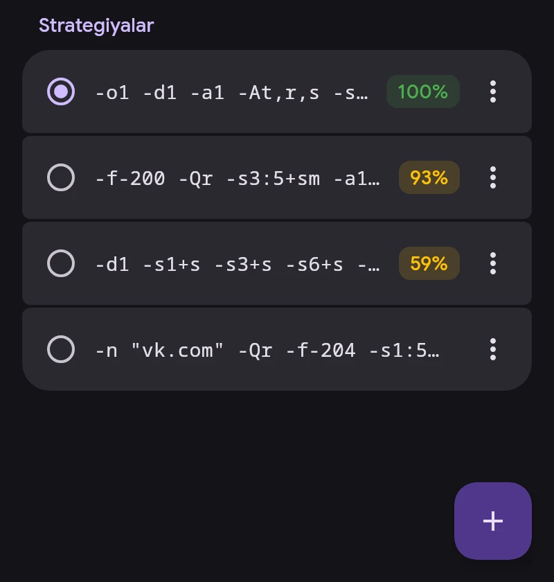

# ByeDPI

ByeDPI (ciadpi) paketlarni qurilmada provayder DPI ularni tanimaydigan qilib oʻzgartiradi. Server kerak emas. Qanday oʻzgartirishni strategiya — ciadpi argumentlari toʻplami belgilaydi.

## Strategiyalar

- Bosish strategiyani qoʻllaydi. VPN ulangan boʻlsa, faqat ByeDPI qayta ishga tushadi.
- Foiz — joriy tarmoqdagi oxirgi tekshiruvda ochilgan saytlar ulushi: Wi-Fi yoki operatorli mobil tarmoq. Foiz boʻlmasa, strategiya bu tarmoqda hali tekshirilmagan.
- ⋮ — saytlar va tarmoqlar boʻyicha batafsil, tekshirish, toʻliq test, tahrirlash, nomini oʻzgartirish, mahkamlash, oʻchirish.
- Uzoq bosish — oʻchirish uchun bir nechtasini tanlash.
- Mahkamlanmagan oxirgi 30 ta strategiya saqlanadi. Mahkamlanganlar va faoli oʻchirilmaydi.

## Tekshirish

Burchakdagi tugma → «Hammasini tekshirish». Har bir strategiya alohida ciadpi’da ishga tushadi, bir vaqtda beshtagacha; VPN ulanishi kerak emas. Sahifa toʻliq yuklangandagina sayt ochilgan hisoblanadi.

- Tez tekshiruv — ByeByeDPI’dagidek YouTube va Google Video’ning 32 ta manzili.
- Toʻliq test — qoʻshimcha ravishda Discord, Telegram, ijtimoiy tarmoqlar, Cloudflare va boshqalar.

«Hammasini tekshirish»dan soʻng roʻyxat natija boʻyicha saralanadi.

## Strategiya tanlash

«Strategiya tanlash» ByeByeDPI’dagi tayyor strategiyalar roʻyxatini yoki har qatorda bittadan strategiya yozilgan oʻz roʻyxatingizni tekshiradi. SNI soxta paketli strategiyalarga qoʻyiladi, standart qiymati `google.com`. Mos strategiyalarni qoʻllash yoki roʻyxatga qoʻshish mumkin.

## DNS

ByeDPI trafigi uchun sayt manzillarini «Sozlamalar → Tarmoq»dagi «ByeDPI uchun DNS» aniqlaydi: standart holatda shifrlangan (DoT) 1.1.1.1.

ciadpi argumentlari: [byedpi tavsifi](https://github.com/hufrea/byedpi#readme).
