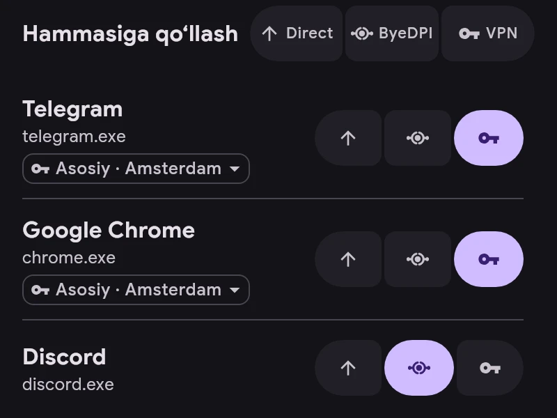

# Kanallar

Har bir ilova kanallardan biri orqali ishlaydi:

- **Direct** — tunneldan tashqarida, ERKINsiz holatdagidek.
- **ByeDPI** — qurilmadagi ByeDPI orqali, server kerak emas.
- **VPN** — server orqali.

- Kanal ilovaning oʻng tomonidagi tugmalar bilan oʻzgartiriladi.
- «Hammasiga qoʻllash» kanalni roʻyxatdagi barcha ilovalarga, qidiruvda esa faqat topilganlariga qoʻyadi. Amalni bekor qilish mumkin.
- VPN’dagi ilova nomi ostida server koʻrsatilgan. Asosiy server oʻrniga ilovaga alohida server tanlash uchun ustiga bosing.
- Yangi ilovalar uchun kanal «Sozlamalar → Ilovalar»da belgilanadi. ru, vk va yandex ilovalari Direct bilan boshlanadi.
- Qoidalar kanaldan ustun: ulanish qoidaga mos kelsa, qoida koʻrsatgan joyga ketadi.
