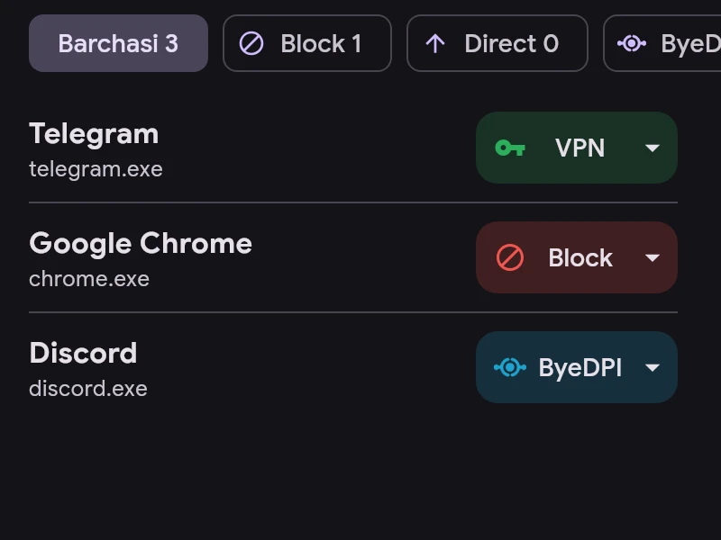

# Kanallar

Har bir ilova kanallardan biri orqali ishlaydi:

- **Bypass** — ERKIN’ni chetlab, usiz holatdagidek. Ilova tunneldan tashqarida, qoidalar unga taʼsir qilmaydi. Faqat Android’da bor.
- **Direct** — ERKIN orqali toʻgʻridan-toʻgʻri, serversiz. Qoidalar ishlaydi, ilova «Ulanishlar»da koʻrinadi, lekin VPN’ni koʻradi.
- **ByeDPI** — qurilmadagi ByeDPI orqali, server kerak emas.
- **VPN** — server orqali.
- **Block** — ERKIN ulangan paytda tarmoqqa kirishsiz.

- Kanal ilovaning oʻng tomonidagi tugma bilan tanlanadi. Ilovaning alohida serveri boʻlsa, tugmada uning nomi yoziladi.
- Menyuda VPN ostidagi «Server» qatori ilovaga asosiy server oʻrniga alohida server yoki zanjir beradi.
- Roʻyxat ustidagi filtrlar har bir kanalda nechta ilova borligini koʻrsatadi va ularni saralaydi. Kanallardan keyin ilovalar bogʻlangan serverlar va zanjirlar keladi.
- Bir nechta ilovani birdaniga oʻzgartirish uchun ilovani bosib turing yoki qidiruv maydonidagi tanlash tugmasini bosing, ilovalarni belgilang va kanal yoki serverni tanlang. Amalni bekor qilish mumkin.
- Yangi ilovalar uchun kanal «Sozlamalar → Ilovalar»da belgilanadi. ru, vk va yandex ilovalari Bypass bilan boshlanadi.
- Qoidalar kanaldan ustun: ulanish qoidaga mos kelsa, qoida koʻrsatgan joyga ketadi. Batafsil — «Qoidalar va ulanishlar» maqolasida.
- Block umumiy qoidalardan ustun: bloklangan ilovaga tarmoqni faqat uning oʻz qoidalari ochadi.

## Zanjirlar

«Zanjirlar» boʻlimida bir nechta serverdan yoʻl yigʻish mumkin: kirish, oraliq boʻgʻinlar va chiqish serveri. Birinchi boʻgʻin ByeDPI boʻlishi mumkin. Boʻgʻinlar dastagidan sudrab joyi almashtiriladi. Zanjirni asosiy server yoki ilova serveri qilib tanlash mumkin, «Kechikishni tekshirish» esa uni butunligicha oʻlchaydi.
