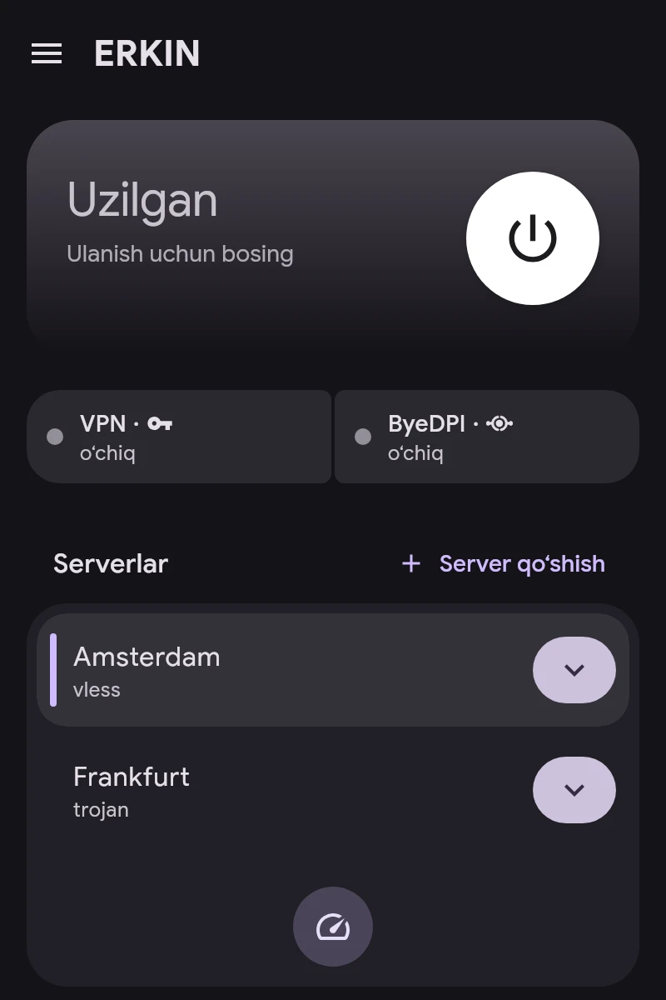

# Tez boshlash

1. **Server qoʻshing.** Bosh ekranda — «Server qoʻshish». `vless://`, `vmess://`, `trojan://`, `ss://`, `hysteria2://`, `tuic://`, `anytls://`, `socks5://`, `https://` va AmneziaWG `vpn://` havolalari, obuna havolasi yoki WireGuard, AmneziaWG yoxud OpenVPN konfiguratsiya fayli mos keladi.
2. **Asosiy serverni tanlang** — roʻyxatda ustiga bosing. «Kechikishni tekshirish» barcha serverlarning javobini oʻlchaydi.
3. **Ilovalarga kanal belgilang** — «Ilovalar» boʻlimida: VPN, ByeDPI yoki Direct. Batafsil — «Kanallar» maqolasida.
4. **Ulaning** — bosh ekrandagi tugma bilan.

Ulanish kartasi VPN va ByeDPI holatini koʻrsatadi. ByeDPI ustiga bosilsa, uning boʻlimi ochiladi.
