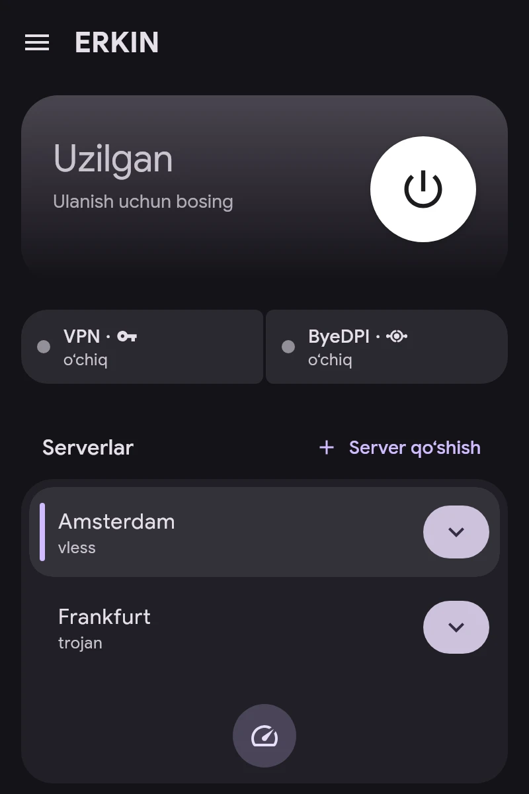

# Tez boshlash

1. **Server qoʻshing.** Bosh ekranda — «Server qoʻshish». `vless://`, `vmess://`, `trojan://`, `ss://`, `hysteria2://`, `tuic://`, `anytls://`, `socks5://`, `https://` va AmneziaWG `vpn://`, `amneziawg://` havolalari, obuna havolasi yoki WireGuard, AmneziaWG yoxud OpenVPN konfiguratsiya fayli mos keladi.
2. **Asosiy serverni tanlang** — roʻyxatda ustiga bosing. «Kechikishni tekshirish» barcha server va zanjirlarning javobini oʻlchaydi; «Ping boʻyicha saralash» yoqilgan boʻlsa, roʻyxat natija boʻyicha tartiblanadi.
3. **Ilovalarga kanal belgilang** — «Ilovalar» boʻlimida: Bypass, Direct, ByeDPI, VPN yoki Block. Batafsil — «Kanallar» maqolasida.
4. **Ulaning** — bosh ekrandagi tugma yoki tezkor sozlamalar pardasidagi ERKIN plitkasi bilan.

Ulanish kartasi «Ulangan» deb faqat ishlatilayotgan barcha kanallar javob berganda koʻrsatadi. «Javob yoʻq» VPN-server yoki ByeDPI javob bermayotganini bildiradi: qaysi biri ekanligi yozuvda aytiladi. ByeDPI ustiga bosilsa, uning boʻlimi ochiladi.

VPN-server javob bermasa, ERKIN uch marta qayta ulanadi. Bu yordam bermasa, u obunani yangilaydi va undagi eng tez serverga oʻtadi.
