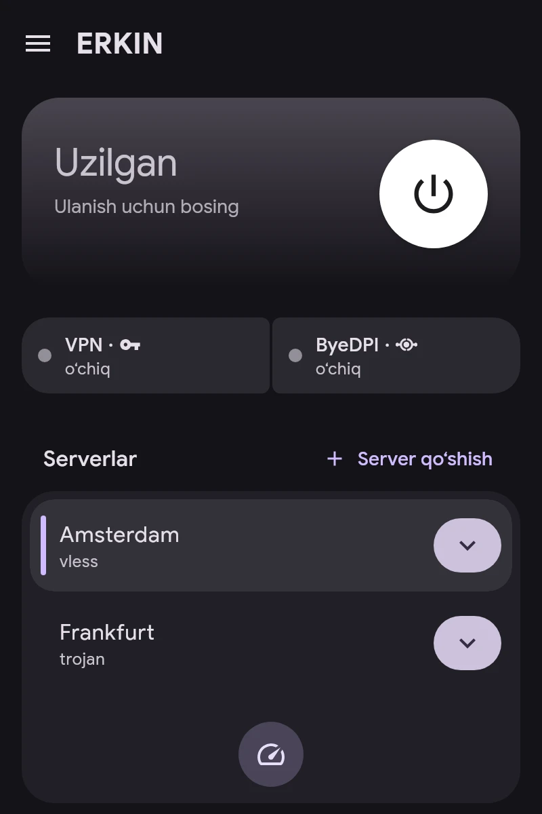

# Tez boshlash

1. **Server qoʻshing.** Bosh ekranda — «Server qoʻshish». `vless://`, `vmess://`, `trojan://`, `ss://`, `hysteria2://`, `tuic://`, `anytls://`, `socks5://`, `https://` va AmneziaWG `vpn://`, `amneziawg://` havolalari, obuna havolasi yoki WireGuard, AmneziaWG yoxud OpenVPN konfiguratsiya fayli mos keladi.
2. **Asosiy serverni tanlang** — roʻyxatda ustiga bosing. «Kechikishni tekshirish» barcha server va zanjirlarning javobini oʻlchaydi; «Ping boʻyicha saralash» yoqilgan boʻlsa, roʻyxat natija boʻyicha tartiblanadi.
3. **Ilovalarga kanal belgilang** — «Ilovalar» boʻlimida: Bypass, Direct, ByeDPI, VPN yoki Block. Batafsil — «Kanallar» maqolasida.
4. **Ulaning** — bosh ekrandagi tugma yoki tezkor sozlamalar pardasidagi ERKIN plitkasi bilan.

Ulanish kartasi «Ulangan» deb faqat ishlatilayotgan barcha kanallar javob berganda koʻrsatadi. «Javob yoʻq» VPN-server yoki ByeDPI javob bermayotganini bildiradi: qaysi biri ekanligi yozuvda aytiladi. ByeDPI ustiga bosilsa, uning boʻlimi ochiladi.

VPN-server javob bermay qolsa, ERKIN darhol shu guruh yoki obunadagi birinchi javob bergan serverga oʻtadi. Avval ishlagan server yana bir bor tekshiriladi, shuning uchun tarmoqning qisqa almashuvi uni oʻzgartirmaydi. Boshqa serverlar javob bermasa, ERKIN yadroni qayta ishga tushiradi, soʻng obunani yangilab, yana qidiradi.

Obuna oynasi uning kartasi bilan boshlanadi: trafik va amal qilish muddati, bosilganda esa oxirgi yangilanish vaqti, provayder eʼloni hamda «Yordam» va «Kabinet» tugmalari. ERKIN obunani provayder soʻraganicha tez-tez yoki kuniga bir marta yangilaydi. Clash obunasi oʻz marshrutlash qoidalarini ham olib kelishi mumkin: kartada «Qo‘llash»ni yoqing, shunda ular sizning qoidalaringizdan keyin, asosiy server shu obunadan olingan paytda ishlaydi.
