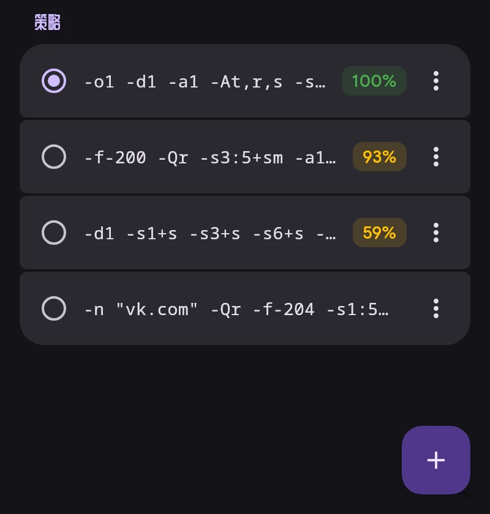

# ByeDPI

ByeDPI（ciadpi）在设备上修改数据包，使运营商的 DPI 无法识别。无需服务器。如何修改由策略决定，即一组 ciadpi 参数。

## 策略

- 点按策略即可应用。已连接时只重启 ByeDPI。
- 百分比是当前网络上次测试中能打开的网站比例：Wi-Fi，或带运营商的移动网络。没有百分比表示尚未在此网络上测试。
- ⋮ 菜单：按网站和网络查看详情、测试、完整测试、编辑、重命名、置顶、删除。
- 长按可多选并删除。
- 保留最近 30 个未置顶的策略。置顶的和当前使用的不会被删除。

## 测试

角落按钮 → “全部测试”。每个策略在单独的 ciadpi 中运行，最多同时五个；无需连接 VPN。只有页面完整加载才算网站能打开。

- 快速测试检查 32 个 YouTube 和 Google Video 地址，与 ByeByeDPI 相同。
- 完整测试另外检查 Discord、Telegram、社交网络、Cloudflare 等。

“全部测试”后列表按结果排序。

## 寻找策略

“寻找策略”测试 ByeByeDPI 自带的策略列表，或您自己的列表（每行一个策略）。SNI 会填入使用伪造数据包的策略，默认为 `google.com`。合适的策略可以直接应用或加入列表。

## DNS

ByeDPI 流量的域名由“设置 → 网络”中的“ByeDPI DNS”解析：默认为加密（DoT）的 1.1.1.1。

ciadpi 参数：[byedpi 说明](https://github.com/hufrea/byedpi#readme)。
