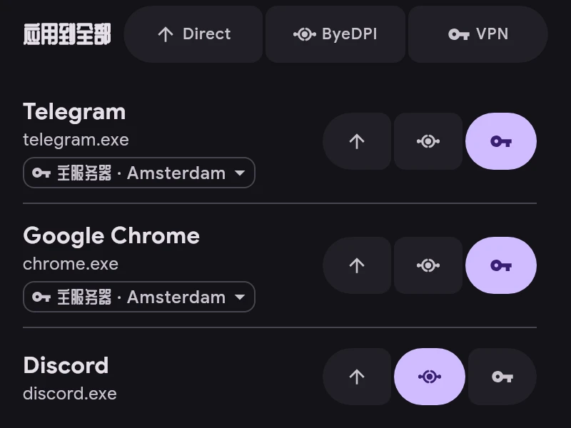

# 通道

每个应用使用一个通道：

- **Direct** — 不经过隧道，与没有 ERKIN 时相同。
- **ByeDPI** — 经由设备上的 ByeDPI，无需服务器。
- **VPN** — 经由服务器。

- 用应用右侧的按钮切换通道。
- “应用到全部”为列表中的所有应用设置通道；搜索时仅作用于搜索结果。可以撤销。
- 使用 VPN 的应用在名称下方显示其服务器。点按它可为该应用选择单独的服务器，代替主服务器。
- 新应用的通道在“设置 → 应用”中设置。ru、vk 和 yandex 应用默认使用 Direct。
- 规则优先于通道：匹配规则的连接按规则指定的方向走。
