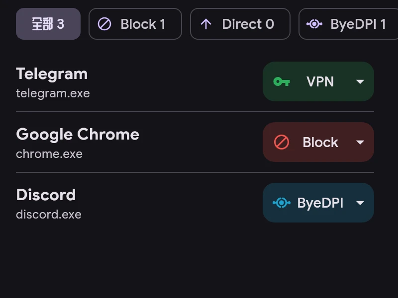

# 通道

每个应用使用一个通道：

- **Bypass** — 绕过 ERKIN，与没有 ERKIN 时相同。应用在隧道之外，规则对它不生效。仅限 Android。
- **Direct** — 经 ERKIN 直连，无需服务器。规则生效，应用会显示在“连接”中，但它能看到 VPN。
- **ByeDPI** — 经由设备上的 ByeDPI，无需服务器。
- **VPN** — 经由服务器。
- **Block** — ERKIN 连接期间无法访问网络。

- 点按应用右侧的按钮选择通道。如果应用有自己的服务器，按钮上会显示服务器名称。
- 在菜单中，VPN 下方的“服务器”一行可为应用指定单独的服务器或代理链，代替主服务器。
- 列表上方的筛选显示每个通道中的应用数量，并可筛选列表。通道之后是应用绑定的服务器和代理链。
- 要同时修改多个应用，请长按一个应用或点按搜索框中的选择按钮，勾选应用后选择通道或服务器。可以撤销。
- 新应用的通道在“设置 → 应用”中设置。ru、vk 和 yandex 应用默认使用 Bypass。
- 规则优先于通道：匹配规则的连接按规则指定的方向走。详见“规则和连接”。
- Block 优先于通用规则：只有被阻止应用自己的规则才能为它开放网络。

## 代理链

在“代理链”中可以用多个服务器组成一条路径：入口、中间节点和出口服务器。第一个节点可以是 ByeDPI。拖动手柄即可调整节点顺序。代理链可以作为主服务器或某个应用的服务器，“测试延迟”会测量整条链。
