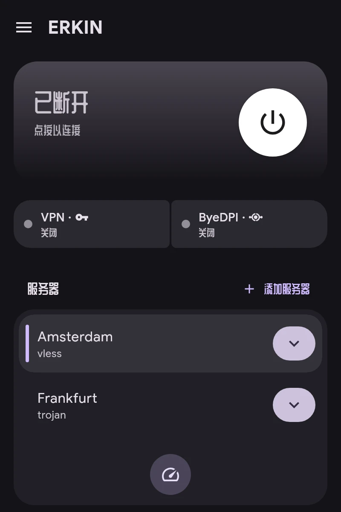

# 快速开始

1. **添加服务器。** 在主屏幕点按“添加服务器”。支持 `vless://`、`vmess://`、`trojan://`、`ss://`、`hysteria2://`、`tuic://`、`anytls://`、`socks5://`、`https://` 和 AmneziaWG `vpn://` 链接、订阅链接，以及 WireGuard、AmneziaWG 或 OpenVPN 配置文件。
2. **选择主服务器**：在列表中点按它。“测试延迟”会测量所有服务器和代理链的响应；开启“按延迟排序”后列表按结果排列。
3. **为应用分配通道**：在“应用”中选择 Bypass、Direct、ByeDPI、VPN 或 Block。详见“通道”。
4. **连接**：点按主屏幕上的按钮，或快速设置中的 ERKIN 磁贴。

只有正在使用的所有通道都有响应时，连接卡片才显示“已连接”。“无响应”表示 VPN 服务器或 ByeDPI 没有响应，下方一行会说明是哪一个。点按 ByeDPI 可打开其页面。

如果 VPN 服务器停止响应，ERKIN 会重连三次。仍然无效时，它会更新订阅并切换到其中最快的服务器。
