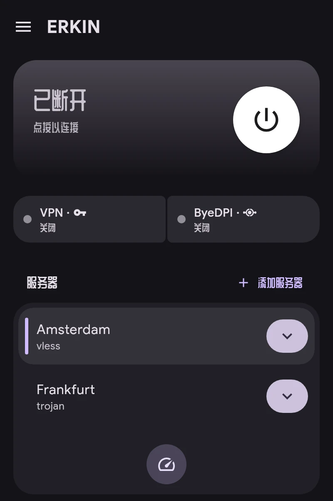

# 快速开始

1. **添加服务器。** 在主屏幕点按“添加服务器”。支持 `vless://`、`vmess://`、`trojan://`、`ss://`、`hysteria2://`、`tuic://`、`anytls://`、`socks5://`、`https://` 和 AmneziaWG `vpn://` 链接、订阅链接，以及 WireGuard、AmneziaWG 或 OpenVPN 配置文件。
2. **选择主服务器**：在列表中点按它。“测试延迟”会测量所有服务器的响应。
3. **为应用分配通道**：在“应用”中选择 VPN、ByeDPI 或 Direct。详见“通道”。
4. **连接**：点按主屏幕上的按钮。

连接卡片显示 VPN 和 ByeDPI 的状态。点按 ByeDPI 可打开其页面。
